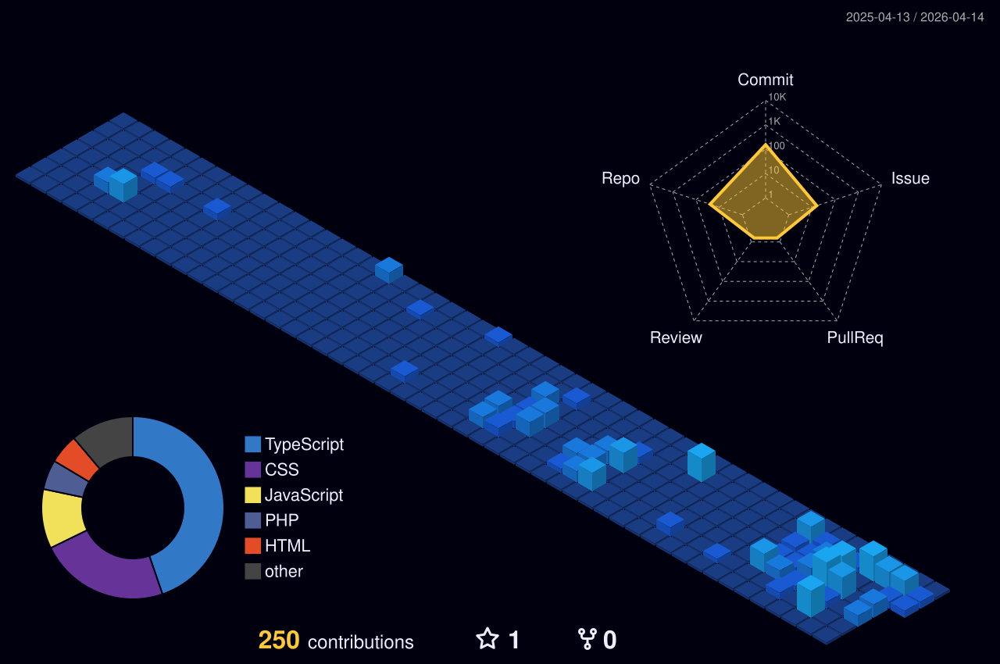

 

  

 
 
### Main skills:
&nbsp;
&nbsp;
&nbsp;
&nbsp;
&nbsp;

### Tools:
&nbsp;
&nbsp;
&nbsp;

### Other Knowledge:
&nbsp;
&nbsp;
&nbsp;
&nbsp;
&nbsp;
&nbsp;
&nbsp;

### Studying in this moment:
&nbsp;
&nbsp;
&nbsp;

